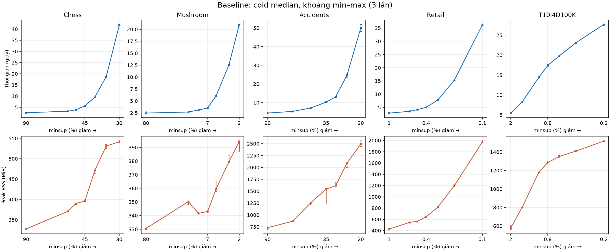
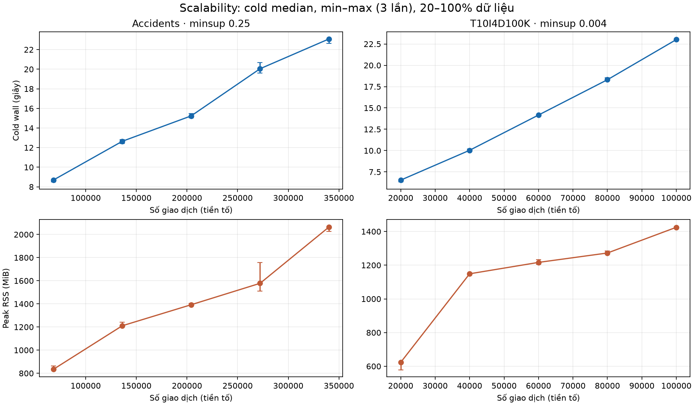
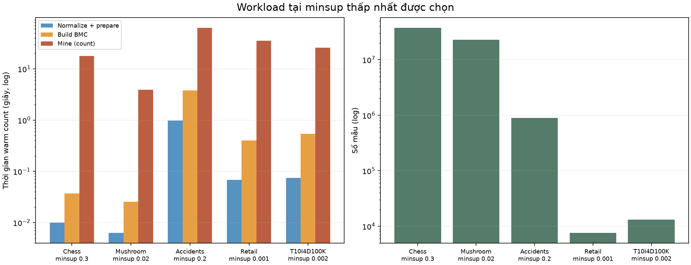

# Phân tích sơ bộ benchmark Baseline

Nguồn: `runs.csv` và `phases.csv` của lượt chạy 13/11/2026 trên commit `3ecd0c1`, được đối chiếu với [benchmark-baseline.md](benchmark-baseline.md). Gói số liệu thô được giữ local tại `results/handoff/benchmark-baseline-20261113/`; xem [hướng dẫn bàn giao](benchmark-handoff.md). Lượt đo dùng Julia 1.12.0 một luồng, Windows 11, i5-13600K và RAM 31,75 GiB; xem báo cáo nguồn về cấu hình và các sửa đổi sau lượt chạy.

## Hình và cách đọc

Mỗi cột là một dataset với thang trục riêng. `minsup` thể hiện bằng phần trăm và giảm về bên phải; mỗi điểm là median của 3 lần cold, thanh lỗi là min–max. Cold bao gồm khởi động Julia, JIT, đọc và ghi. Peak RSS là đỉnh của toàn process, bao gồm runtime Julia. Không so sánh tổng byte cấp phát với peak RSS.

Đây là median và khoảng min–max của 3 lần cold từ dữ liệu thô cho các **tiền tố 20%, 40%, 60%, 80%, 100%**, giữ minsup tương đối cố định. Dữ liệu chưa bao gồm các tỷ lệ 10%, 25%, 50%, 75%, 100% được ghi trong checklist đồ án.

Workload ứng với minsup thấp nhất đã chọn ở mỗi tập. Các cột thời gian là median warm count theo từng giai đoạn; normalize + prepare là median của tổng theo từng lần, không phải tổng hai median. Số mẫu lấy từ run. Hai trục dọc là log; hình không gồm thời gian ghi output và collect Nodeset.

Tái tạo từ checkout chính bằng `python docs/validation/plot-benchmark.py results/handoff/benchmark-baseline-20261113/full-run/20261113-154220` sau khi cài matplotlib. Nếu chạy ở worktree khác, truyền đường dẫn đến gói trong checkout chính. Script không tải dữ liệu benchmark.

## Kết quả đáng chú ý

- Retail ở minsup 0,001: cold median 36,165 s, peak RSS 1.973,3 MiB, 7.589 mẫu; báo cáo ghi 320.412.112 record NegNodeset được quét. Cấu hình này hữu ích để khảo sát chi phí khai thác khi output nhỏ.
- Chess ở minsup 0,3: 37.282.962 mẫu, output 1.406,1 MiB, cold median 41,681 s; phù hợp khảo sát chi phí tạo và xuất mẫu.
- Accidents ở minsup 0,2: cold median 49,965 s và peak RSS 2.495,7 MiB; có thể dùng để khảo sát RAM và cây BMC lớn.
- Warm count của Retail 0,001 dao động 34,7–55,9 s; cần xét từng lần lặp, không suy ra cải thiện nhỏ chỉ từ median. Báo cáo nêu cold và warm khác nhau đáng kể; không coi hiệu hai phép đo khác phạm vi là chi phí ghi chính xác hay cận trên có bảo đảm.
- Lượt chính chạy trước các sửa runner và phase hook. Phép so sánh bổ sung trên Chess 0,4 chưa đủ để khẳng định tác động trên mọi dataset/ngưỡng.

## Công việc tiếp theo đề xuất

1. Đối chiếu đầy đủ 581 lượt số liệu thô đã nhận với báo cáo và cập nhật đồ thị từ CSV; hiện mới kiểm tra số lượt, trạng thái và một số giá trị đại diện. Ghi rõ nơi lưu dữ liệu và quyền truy cập; không tự đưa dữ liệu lớn lên Git.
2. Đo bổ sung scalability ở 10/25/50/75/100% hoặc xác nhận thay thế được chấp nhận. Ghi phương pháp lấy mẫu, thứ tự, seed nếu có và số mẫu; tiền tố có thể mang thiên lệch theo thứ tự dữ liệu.
3. Trên Retail 0,001 và Chess 0,3, profiling riêng chi phí quét NegNodeset, phép toán bitmap, tạo vector và ghi output; lặp thêm một workload Accidents để kiểm tra RAM. Các nguồn cấp phát này hiện là giả thuyết.
4. Sau profiling, lập kế hoạch Optimized theo một giả thuyết tại một thời điểm. Giữ Baseline BigInt và contract callback; kiểm chứng oracle, toàn bộ test và SPMF, rồi so runtime, RSS và output trong cùng môi trường và phạm vi. Báo cả trường hợp không cải thiện.
5. Hiếu tiếp tục nguồn dữ liệu công khai khớp checksum và benchmark; Tiến làm pipeline ứng dụng cùng notebook. Cập nhật phần báo cáo khi có bằng chứng.

Đã có [profiling thăm dò](profiling-pilot.md) trên ba tập và [kế hoạch thí nghiệm Optimized](../superpowers/plans/2026-11-14-negfin-optimized-experiment.md). Các phát hiện mới chỉ dùng để chọn giả thuyết, chưa chứng minh có tăng tốc.
